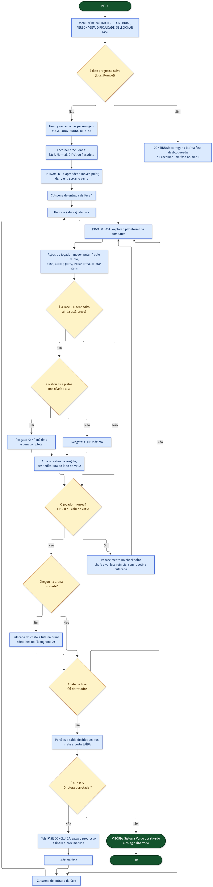

# Fluxogramas — CÓDIGO VERDE (CEPK)

Fluxogramas do jogo [CÓDIGO VERDE](https://github.com/pedrosokaua-lab/CEPK), disponíveis em formato de imagem (`.png`).

## Fluxo geral do jogo

Início, menu, seleção de personagem e dificuldade, treinamento, fases com as ações do jogador, decisões (morte e renascimento, resgate de Kennedito, arena do chefe), condições de vitória/derrota e encerramento.

## Combate na arena do chefe

Entrada na arena e cutscene, ações do jogador (mover, pular duplo, dash, atacar, ataque carregado, parry, trocar de arma), decisões sobre parry/dash, fases do chefe (66% e 32% de HP), derrota do chefe ou morte do jogador com reset da luta.

## Versões editáveis no Excalidraw

- **Fluxo geral do jogo:** [abrir no Excalidraw](https://excalidraw.com/#json=o5CcfJYfCDiyDNMFx-eqv,fXNjoW8dDtH68Irqn78JZQ) · [baixar `.excalidraw`](fluxograma-geral.excalidraw)
- **Combate na arena do chefe:** [abrir no Excalidraw](https://excalidraw.com/#json=aotDFBo7Yo9HM67SkSsJg,MP91m7YwM3xYnB6iyzrNjg) · [baixar `.excalidraw`](fluxograma-combate.excalidraw)

Os links abrem uma cópia do desenho no Excalidraw; os arquivos `.excalidraw` também podem ser importados pelo menu **File → Open**.

## Símbolos utilizados

- **Terminal (elipse):** início e fim
- **Retângulo:** processos e ações
- **Losango:** decisões
- **Setas:** fluxo, com caminhos rotulados (Sim / Não)
